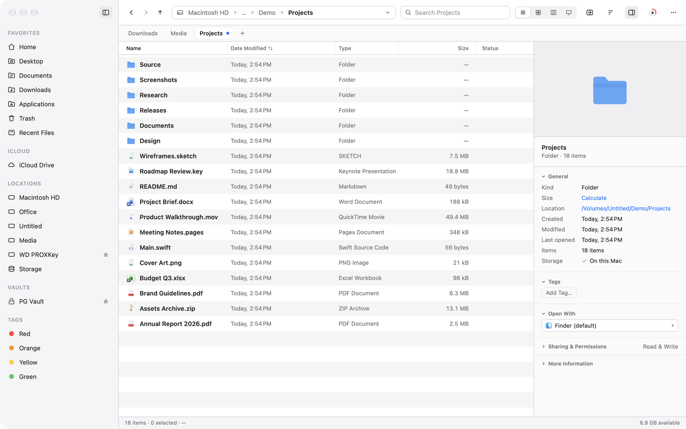
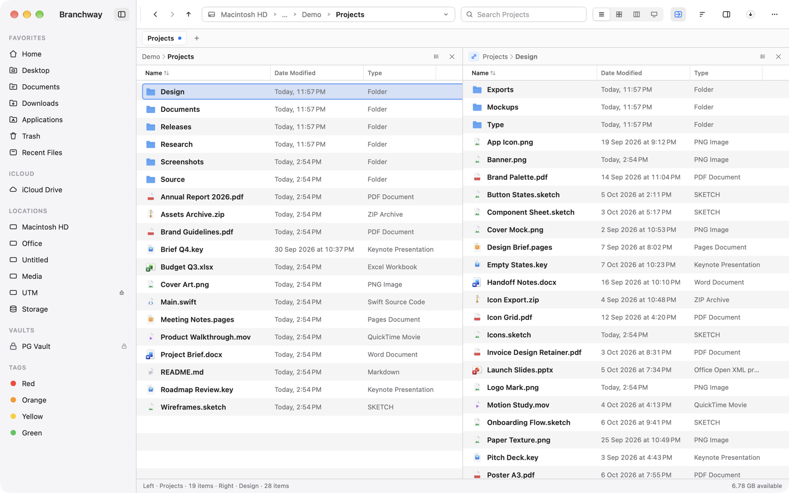
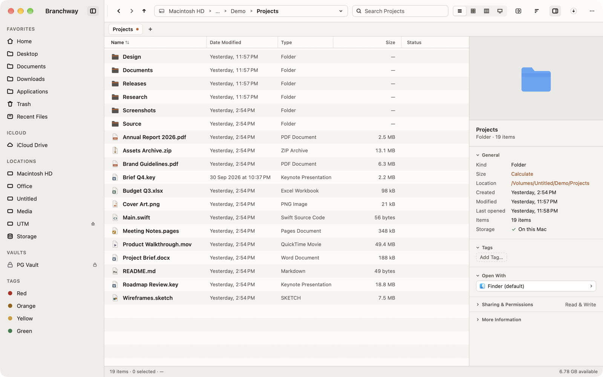
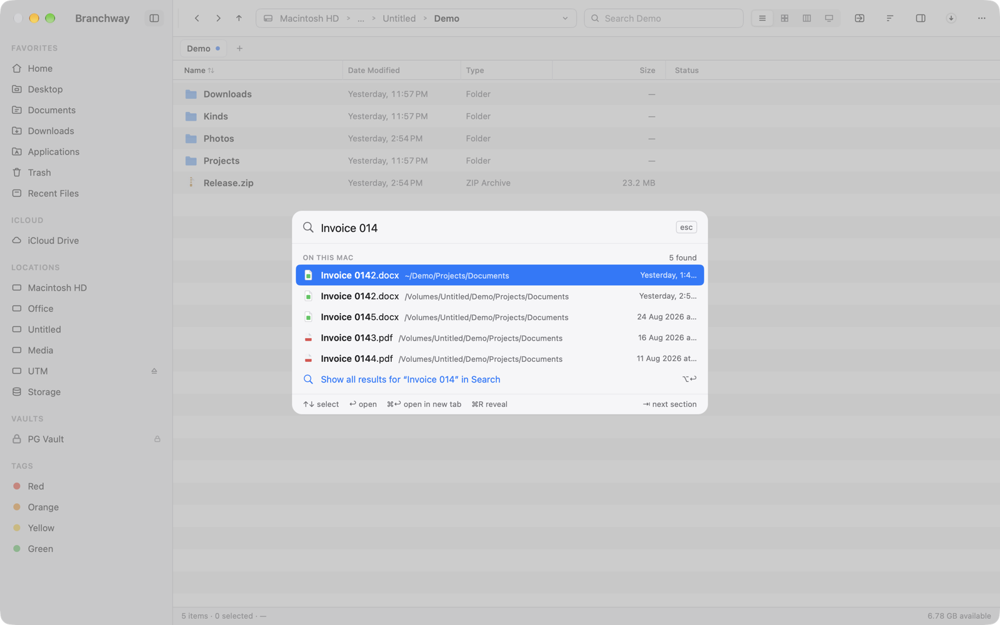
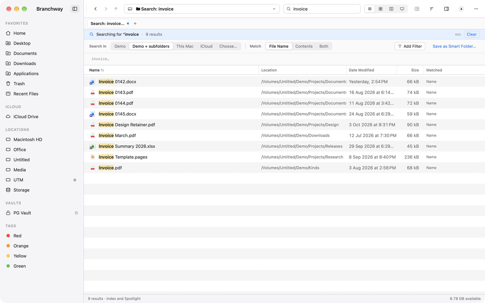
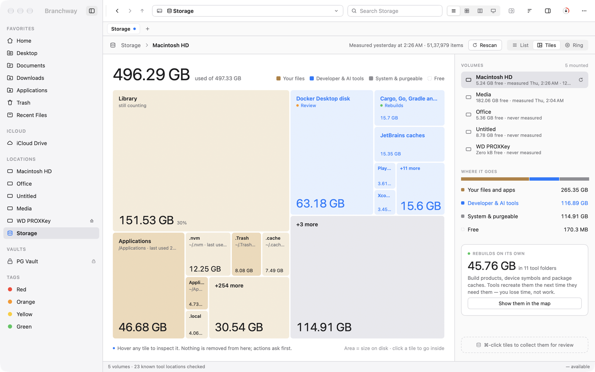
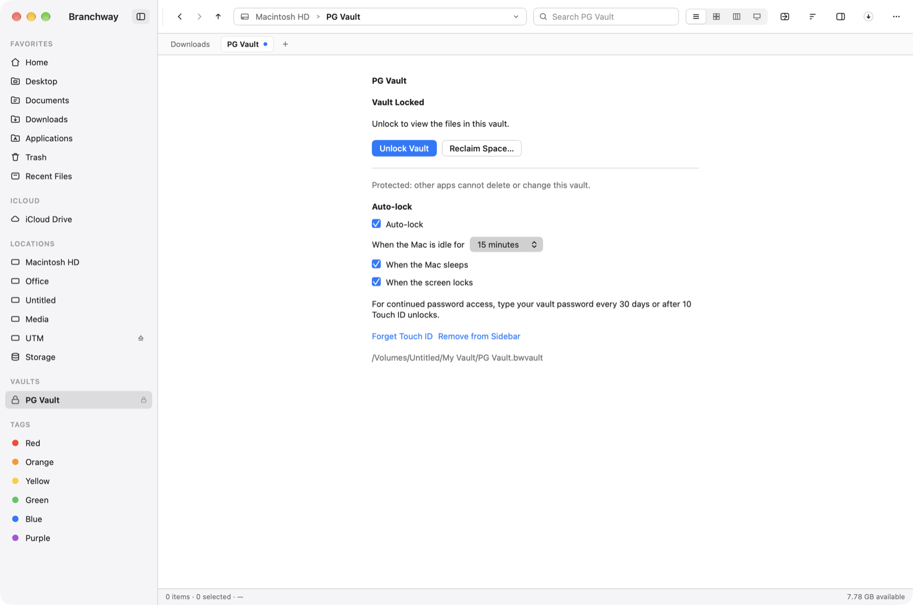
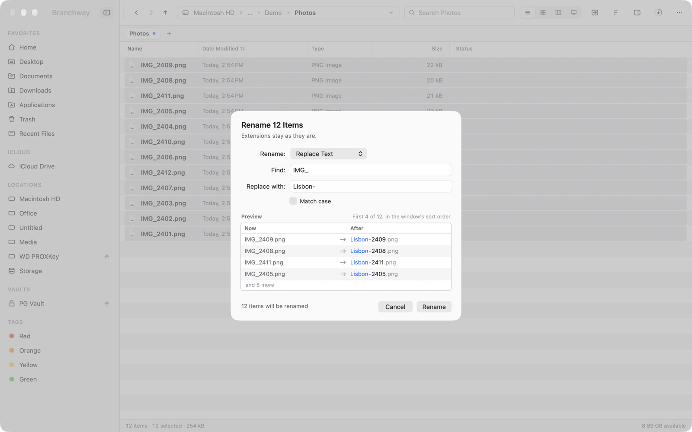

<picture>
  <source media="(prefers-color-scheme: dark)" srcset="assets/hero-ridge-dark.png">
  
</picture>

# Branchway

**A fast, native file manager for macOS, made by [Evenpine](https://evenpine.com).**

[Install](#install) · [Feature tour](#feature-tour) · [Docs](docs/getting-started.md) · [Help](https://evenpine.com/branchway/help) · [Changelog](CHANGELOG.md)

> **Status: pre-release.** This repository is the public home for Branchway's downloads, update feed and
> optional search-model channel. It goes live with the first notarized release. Until then the
> Releases page is empty and the feed has no entries.

Branchway keeps the speed and the keyboard of a power-user file manager and the polish of a Mac app.
Dual panes, tabs, a command palette, a real storage view, encrypted vaults, and search that understands
a plain sentence. Everything runs on your Mac.

<picture>
  <source media="(prefers-color-scheme: dark)" srcset="assets/s01-hero-dark.png">
  
</picture>

## Feature tour

### Home
Home is the first row in the sidebar. It gathers what is useful right now: places you work in,
files you left unfinished, review lists such as old installers, and **Commands**, saved shell lines you
run from the folder you are in. Home learns only from your own activity on this Mac, can be paused,
and can be cleared in Settings.

### Dual pane and tabs
Two folders side by side, tabs in each window, and sync browsing when you want both panes to follow.
Copy and move between panes with the keyboard. List, icon, column and gallery views share one set of
selection and drag rules.

<picture>
  <source media="(prefers-color-scheme: dark)" srcset="assets/s06-dualpane-dark.png">
  
</picture>

### Themes
Four themes ship: **Default**, **Evenpine**, **Graphite Ember** and **Paper Lantern**, each in light and
dark. Paper Lantern adds optional playful details, set in Settings › Appearance. See [themes](docs/themes.md).

<picture>
  <source media="(prefers-color-scheme: dark)" srcset="assets/s27-ember-dark.png">
  
</picture>

### Command palette (⌘K)
Type to find a command, a place or a file. Type a plain sentence and the palette offers to search for it.

<picture>
  <source media="(prefers-color-scheme: dark)" srcset="assets/s07-palette-dark.png">
  
</picture>

### Search that reads sentences
Search with words, with chips (`kind:`, `size:`, `modified:`, `tag:`, `in:`), or with a sentence such as
"pdfs bigger than 5 MB from last month". The interface is localized in 16 languages. Sentence search
understands English. Photo search can also match words and labels found inside pictures. See the
[search guide](docs/search-guide.md).

<picture>
  <source media="(prefers-color-scheme: dark)" srcset="assets/s08-search-dark.png">
  
</picture>

### Storage, Large Files and Disk Usage
**Storage** maps where a volume's space goes as tiles, by category. **Large Files** lists the biggest files
on a volume so you can review and move them to the Trash. **Disk Usage** shows the same idea for any
folder you choose. Nothing is removed without you asking. See
[storage and large files](docs/storage-and-large-files.md).

<picture>
  <source media="(prefers-color-scheme: dark)" srcset="assets/s11-storage-dark.png">
  
</picture>

### Vaults
A vault is an AES-256 encrypted APFS sparse bundle that you lock and unlock from the sidebar, with
optional Touch ID and an auto-lock policy per vault. There is no password reset, by design. See
[vaults](docs/vaults.md).

<picture>
  <source media="(prefers-color-scheme: dark)" srcset="assets/s24-vault-locked-dark.png">
  
</picture>

### Batch rename
Rename any number of files at once with a live preview of every new name before anything changes, and
undo the whole batch in one step.

<picture>
  <source media="(prefers-color-scheme: dark)" srcset="assets/s20-rename-dark.png">
  
</picture>

## Install

1. Download the latest `Branchway-<version>.dmg` from [Releases](../../releases).
2. Open the disk image and drag **Branchway** to **Applications**.
3. Open it. Releases are signed and notarized by Apple before they are published here.

Requires **macOS 14 Sonoma or later**. Branchway is distributed directly, not through the Mac App Store.

## First run

A five-step onboarding covers the keyboard profile, the places Branchway starts from, and a few
preferences, including Full Disk Access. A short tour of the window follows. You can reopen the tour
from the Help menu. Details: [getting started](docs/getting-started.md).

You get a **14-day free trial** with every feature on. After the trial, browsing stays free and anything
that changes files asks first. Buying a licence is done on [evenpine.com](https://evenpine.com).

## Updates

Branchway updates itself with [Sparkle](https://sparkle-project.org). It checks once a day, never installs
without asking, and rejects any update that is not signed with Evenpine's key. Turn the daily check off in
Settings › General, or use **Branchway › Check for Updates…**. See [updates](docs/updates.md).

## Smarter photo search model (optional)

Photo search works out of the box by reading labels and text in your pictures, using Apple's own
frameworks. For finding photos from a description, Branchway can use an optional on-device model,
**EmbeddingGemma 2**, about 660 MB to download. It is never installed silently. You choose it in
Settings › Search, it runs only on this Mac, and you can remove it any time. It needs a Mac with Apple
silicon and macOS 15 or later. The model is licensed under Apache 2.0, and its use is subject to the
[Gemma Prohibited Use Policy](https://ai.google.dev/gemma/prohibited_use_policy). Details in
[the model guide](docs/model.md) and [models/](models/README.md).

## Privacy

Your files, names, search queries and image content stay on your Mac. Branchway contains no analytics or
usage telemetry. The only network connections it makes are the ones you can read about in
[privacy](docs/privacy.md): update checks, licence activation and validation, and the optional model download.

## Help and support

- Help: <https://evenpine.com/branchway/help>
- Bugs and ideas: [open an issue](../../issues/new/choose)
- Security: see [SECURITY.md](SECURITY.md)
- Docs: [getting started](docs/getting-started.md), [shortcuts](docs/keyboard-shortcuts.md),
  [FAQ](docs/faq.md), [troubleshooting](docs/troubleshooting.md)

## Licence

Branchway is proprietary software, sold as a one-time licence per major version with a 14-day free
trial. The documentation in this repository is licensed CC BY-NC-ND 4.0. See [LICENSE.md](LICENSE.md).

### NTFS helper (GPLv2)

Branchway's upcoming NTFS support uses a separate helper process that links `libntfs-3g` and is
therefore released under the GPLv2. Its source is in
[branchway-ntfs-helper](https://github.com/prashantguleria/branchway-ntfs-helper). The app itself stays
proprietary, and the two communicate across a process boundary.

## Acknowledgements

- [Sparkle](https://sparkle-project.org), the update framework.
- **EmbeddingGemma 2** by Google DeepMind (Apache 2.0), converted to Core ML by
  [FluidInference](https://huggingface.co/FluidInference) (Apache 2.0) and repackaged by Evenpine.
  Full notices ship with the model download.
- [NTFS-3G](https://github.com/tuxera/ntfs-3g) for the NTFS helper, once it ships.

© Evenpine. Branchway and Evenpine are names of their owner. Mentioned products belong to their owners.
